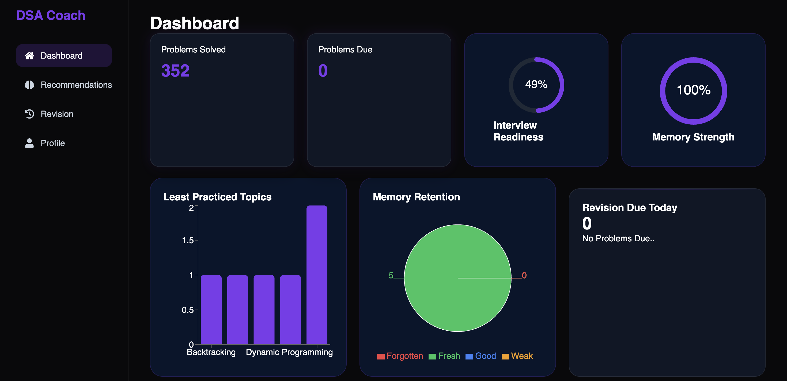
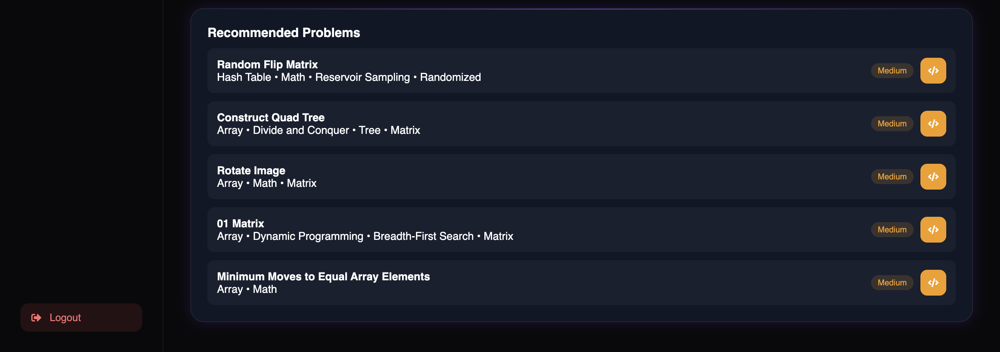
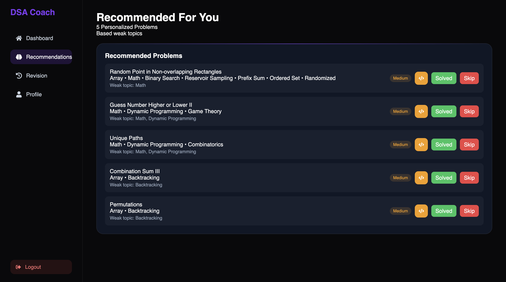
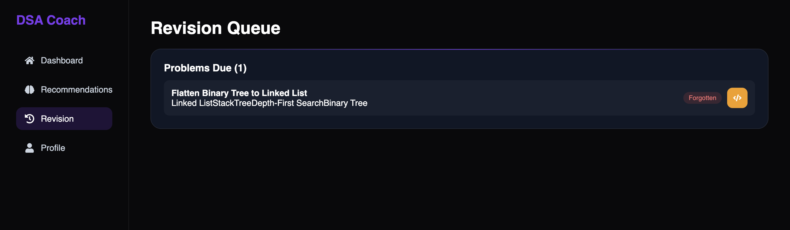
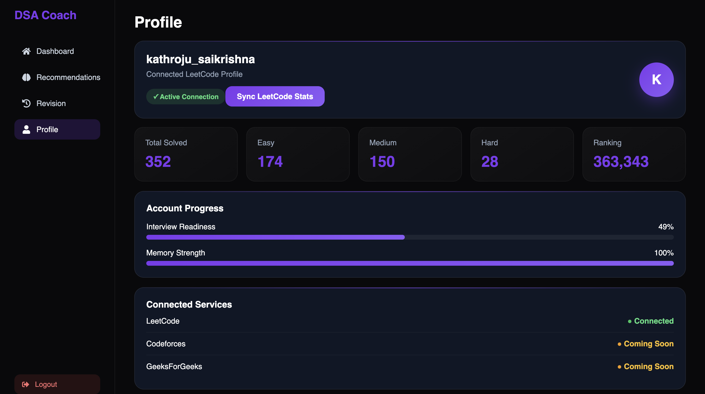

# 🚀 DSA Coach 2.0


## 🌐 Live Demo

**Frontend:** https://dsa-coach-2-0.vercel.app

---

# Overview

DSA Coach 2.0 is a full-stack MERN application that helps developers prepare for coding interviews through personalized learning, AI-powered resume feedback, and a built-in community.

The platform analyzes a user's LeetCode profile, identifies weak topics, recommends relevant problems, tracks memory retention, measures interview readiness, and analyzes resumes with Gemini AI. Users can also share knowledge and job opportunities in a community feed and talk to each other through real-time direct messaging.

Redis caching reduces repeated database queries and unnecessary LeetCode API requests, and a layered security setup protects the API.

---

# Features

## Authentication & Security

- User Registration & Login
- JWT Authentication (2-day expiry)
- Password hashing with bcrypt
- Protected Routes (REST and WebSocket)
- Request validation with Zod
- Input sanitization against NoSQL operator injection
- Security headers with Helmet
- CORS restricted to configured frontend origins
- Rate limiting (general and stricter for auth routes)

---

## LeetCode Integration

- Connect LeetCode Profile
- Fetch Live LeetCode Statistics (total, easy, medium, hard, ranking)
- Sync Progress Anytime
- Store User Progress

---

## Smart Recommendation Engine

- Personalized Problem Recommendations
- Difficulty-Based Recommendations
- Weak Topic Detection
- Recommendation History
- Mark Problems as Solved
- Skip Recommendations

---

## Memory Retention System

- Forgotten Problem Detection
- Revision Queue
- Memory Strength Score
- Retention Classification (Fresh, Good, Weak, Forgotten)
- Revision Priority

---

## Analytics Dashboard

- Interview Readiness Score
- Memory Strength Score
- Weak Topics Analysis
- Progress Tracking
- LeetCode Statistics Visualization

---

## AI Resume Analyzer

- PDF Resume Upload (PDF only, up to 5 MB)
- Analysis powered by Google Gemini (`gemini-2.5-flash`)
- Target-role based evaluation tuned for students and freshers
- Scores for match, coding strength, project strength, and interview readiness
- Strengths, weaknesses, missing skills, resume improvements, and a learning roadmap
- Combines resume content with the user's LeetCode stats
- Usage limit: 3 analyses per 3 hours per user

---

## Community

- Create posts of three types: **discussion**, **question**, and **job**
- Job posts with company, role, location, job type, deadline, and application link
- Comments on posts
- Like / unlike posts
- Tags support (up to 10 per post)
- Search across titles, content, tags, company, and role
- Filter by post type with pagination
- Authors can delete their own posts

---

## Real-Time Chat

- One-to-one direct messaging built on Socket.IO
- Search users by name or email to start a conversation
- Messages are saved to MongoDB before delivery
- Instant delivery to everyone in the conversation
- Conversation list sorted by latest activity
- Read receipts through mark-as-read
- Paginated message history
- JWT-authenticated socket connections with participant-only access to conversations

---

# ⚡ Performance Optimizations

Redis caching using the **Cache-Aside Pattern** improves API performance.

Cached APIs include:

- LeetCode Statistics
- Recommendation Engine
- Memory Analytics
- Interview Readiness
- Weak Topics Analysis

Additional optimizations:

- Redis Cache Invalidation on profile update and problem solve/skip
- TTL-based Cache Expiration
- Reduced MongoDB Queries
- Reduced External LeetCode API Calls
- Route-based code splitting with `React.lazy` and `Suspense` (smaller first load)
- MongoDB indexes on frequently queried fields

---

# 🏗 Architecture

```
                     React (Vercel)
                            │
              ┌─────────────┴─────────────┐
              │                           │
         REST APIs                  WebSocket (Socket.IO)
              │                           │
              └─────────────┬─────────────┘
                            ▼
                 Express.js Backend (Render)
                            │
     ┌──────────────┬───────┴────────┬───────────────┬──────────────┐
     │              │                │               │              │
     ▼              ▼                ▼               ▼              ▼
MongoDB Atlas   Redis Cache   LeetCode GraphQL   Gemini AI   Socket.IO Rooms
     │
     ▼
 Recommendation Engine
 Memory Analytics
 Readiness Scoring
 Resume Analysis
 Community & Chat Data
```

---

# Tech Stack

## Frontend

- React 19
- Vite
- React Router
- Axios
- Recharts
- Socket.IO Client
- GSAP
- React Hot Toast
- React Icons
- CSS3

---

## Backend

- Node.js
- Express 5
- MongoDB & Mongoose
- Redis
- Socket.IO
- JWT Authentication
- bcryptjs
- Zod (validation)
- Helmet & express-rate-limit
- Multer & pdf-parse
- Google Generative AI (Gemini)
- Axios

---

## Testing

- Jest
- Supertest
- MongoDB Memory Server

Test coverage includes authentication, rate limiting, and security behavior.

---

## Deployment

- Vercel (frontend)
- Render (backend)
- MongoDB Atlas
- Redis Cloud

---

# Key Engineering Highlights

- Personalized Recommendation Engine
- Weak Topic Detection
- Memory Retention Analytics
- Interview Readiness Prediction
- AI-powered Resume Analysis with per-user usage limits
- Real-time messaging with authenticated WebSockets
- Community platform with job postings
- Redis-based API Caching and Cache Invalidation
- Input validation, sanitization, and rate limiting
- Automated test suite
- RESTful API Design
- Modular Backend Architecture
- MongoDB Aggregation Pipelines

---

# 📂 Project Structure

```
frontend/
    src/
        components/
        pages/
        services/
        styles/

backend/
    config/
    controllers/
    middleware/
    models/
    routes/
    validators/
    tests/
    app.js
    server.js
    socket.js
    seedProblems.js
```

---

# 📸 Screenshots

## Dashboard





---

## Recommendations



---

## Revision Queue



---

## Profile



---

# 🔌 API Endpoints

All routes except register and login require the header `Authorization: Bearer <token>`.

## Authentication

```
POST /api/auth/register
POST /api/auth/login
GET  /api/me
```

## Profile

```
POST /api/profile
GET  /api/profile
PUT  /api/profile/update
```

## LeetCode

```
GET /api/leetcode/stats
```

## Recommendations

```
GET  /api/recommendations
POST /api/recommendations/:id/solve
POST /api/recommendations/:id/skip
```

## Analytics

```
GET /api/recommendations/memory-score
GET /api/recommendations/readiness
GET /api/recommendations/weak-topics
GET /api/recommendations/history
GET /api/recommendations/forgotten
```

## Resume Analyzer

```
POST /api/resume/analyze      (multipart/form-data: resume [PDF], role)
```

## Community

```
GET    /api/community/posts            (query: page, limit, type, search)
POST   /api/community/posts
POST   /api/community/posts/:id/comments
POST   /api/community/posts/:id/like
DELETE /api/community/posts/:id
```

## Chat

```
GET  /api/chat/users                       (query: search)
GET  /api/chat/conversations
POST /api/chat/conversations
GET  /api/chat/conversations/:id/messages  (query: page, limit)
POST /api/chat/conversations/:id/read
```

## Socket.IO Events

Connect with `auth: { token: "<JWT>" }`.

```
Client → Server   join_conversation   { conversationId }
Client → Server   send_message        { conversationId, content }
Server → Client   new_message         (message object)
```

---

# ⚙ Installation

## Clone Repository

```bash
git clone https://github.com/kathrojusaikrishna/dsa-coach-2.0.git

cd dsa-coach-2.0
```

---

## Backend

```bash
cd backend

npm install

npm run dev
```

Optional: seed the problem database once.

```bash
node seedProblems.js
```

---

## Frontend

```bash
cd frontend

npm install

npm run dev
```

---

## Run Tests

```bash
cd backend

npm test
```

---

# 🔑 Environment Variables

## Backend (.env)

```env
PORT=8000

MONGO_URI=

JWT_SECRET=

GEMINI_API_KEY=

REDIS_HOST=

REDIS_PORT=

REDIS_USERNAME=

REDIS_PASSWORD=

# Comma-separated list of allowed frontend origins
FRONTEND_URL=http://localhost:5173
```

---

## Frontend (.env)

```env
VITE_API_URL=http://localhost:8000/api
```

---

# Motivation

Preparing for coding interviews usually involves solving random problems without tracking strengths and weaknesses.

DSA Coach 2.0 aims to provide a personalized preparation experience by analyzing LeetCode progress, identifying weak concepts, recommending targeted problems, measuring memory retention, estimating interview readiness, giving AI feedback on resumes, and connecting learners through a community and real-time chat.

---

# 🚀 Future Improvements

- Codeforces Integration
- GeeksforGeeks Integration
- Contest Tracking
- Spaced-Repetition Scheduler
- AI-powered Recommendation Engine
- Email Reminders
- Daily Challenge Notifications
- Group Chats and Typing Indicators
- Notifications for Community Replies

---

# Author

**Saikrishna Kathroju**

GitHub: https://github.com/kathrojusaikrishna

LinkedIn: https://www.linkedin.com/in/kathroju-saikrishna/

---

# If you found this project interesting, consider giving it a star!
